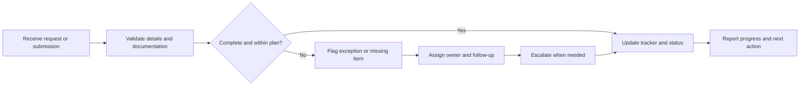

<div align="center">


# Project Operations & Coordination Portfolio

**An interactive portfolio of project coordination, operational tracking, budget monitoring, and delivery-support workflows.**

[](https://Ayush-Kandwal-369.github.io/Project-operations-coordination-portfolio/)
[](https://developer.mozilla.org/en-US/docs/Web/HTML)
[](https://developer.mozilla.org/en-US/docs/Web/CSS)
[](https://developer.mozilla.org/en-US/docs/Web/JavaScript)

*A practical demonstration of how clear ownership, reliable records, and visible status tracking support complex project operations.*

</div>

---

## Project at a glance

<table>
  <tr>
    <td align="center" width="25%">
      <h2>03</h2>
      <strong>Case studies</strong><br>
      <sub>Billing, financial tracking, workflow coordination</sub>
    </td>
    <td align="center" width="25%">
      <h2>04</h2>
      <strong>Interactive demos</strong><br>
      <sub>Checklists, budgets, renewals, tasks</sub>
    </td>
    <td align="center" width="25%">
      <h2>01</h2>
      <strong>Standalone app</strong><br>
      <sub>HTML with embedded CSS and JavaScript</sub>
    </td>
    <td align="center" width="25%">
      <h2>0</h2>
      <strong>Build dependencies</strong><br>
      <sub>No framework or package install required</sub>
    </td>
  </tr>
</table>

> **Scope note:** These figures describe the portfolio's structure, not business-performance results. Demonstration records and financial values are illustrative; this is not a live operational system.

## What this project demonstrates

This portfolio connects project coordination experience with structured operational problem-solving. It presents examples of how teams can track deliverables, surface exceptions, keep documentation review-ready, and make next actions visible.

- **Project coordination** — ownership, follow-ups, cross-functional communication, and issue resolution.
- **Operational visibility** — status summaries, task ownership, due dates, and progress indicators.
- **Financial tracking** — budget-versus-actual comparison, cost variance calculations, and exception flags.
- **Document control** — submission checks, validation stages, outstanding items, and month-wise summaries.
- **Delivery support** — renewal windows, priority tracking, overdue work, and clear next actions.
- **Process discipline** — documented decisions, submission calendars, escalation, and traceable records.

## Interactive showcase

| Demonstration | What you can explore | Skills represented |
|---|---|---|
| **Document checklist** | Change document statuses and review cleared or outstanding items | Document control, quality checks, follow-up |
| **Budget vs. actual simulator** | Adjust illustrative cost values and recalculate variance | Budget monitoring, exception handling, spreadsheet logic |
| **Subconsultant staff tracker** | Review contract dates, renewal windows, and decision status | Dependency tracking, risk awareness, coordination |
| **Task tracker** | Filter tasks by status, priority, and deadline; update completion | Prioritization, action tracking, delivery visibility |

## Workflow model



*This diagram represents the general workflow logic illustrated by the portfolio; it is not an automated backend process.*

## Case studies

### 01 — Project billing & quality control

A case study based on billing coordination for engineering projects at AECOM Global Business Services.

**Focus:** monthly billing cycles, invoice review and finalization, coordination with project teams, quality checks, and traceable records.

### 02 — Budget monitoring & financial tracking

A case study based on project coordination at Surbana Jurong India.

**Focus:** project-specific Excel workbooks, budget heads, monthly actuals, cash sheets, expenses, invoices, vendor costs, contract information, and variance visibility.

### 03 — Site-to-head-office workflow coordination

A case study about coordinating document submission, verification, approval, and payment-related workflows between site teams, project managers, head office, and Finance.

**Focus:** accountable contacts, submission calendars, written records, agreed exceptions, and issue resolution.

## Technology & implementation

<p>
  
  
  
  
  
</p>

- **HTML5** provides the page structure and semantic content.
- **CSS3** handles responsive layouts, styling, themes, and interface components.
- **Vanilla JavaScript** powers interactive tables, calculations, filters, and status updates.
- The application is implemented as a **standalone HTML file**; no package manager or compilation step is required.
- Google Fonts supplies the Source Sans 3 typeface, with system-font fallbacks.

## Run locally

1. Clone the repository:

   ```bash
   git clone https://github.com/Ayush-Kandwal-369/Project-operations-coordination-portfolio.git
   cd Project-operations-coordination-portfolio
   ```

2. Open `index.html` in a modern web browser.

No installation command is needed.

## GitHub Pages deployment

If GitHub Pages is enabled for this repository, the expected URL format is:

**https://Ayush-Kandwal-369.github.io/Project-operations-coordination-portfolio/**

To enable it, open **Settings → Pages**, select **Deploy from a branch**, choose `main` and `/(root)`, then save. If the URL does not load, confirm that Pages has finished deploying and that the repository name and capitalization match.

## Accessibility & responsive design

The implementation includes responsive layouts, a skip-to-content link, visible keyboard focus, selected ARIA states, live announcements for certain updates, and reduced-motion support.

These are implementation features, not a claim of formal accessibility certification. Test the published site across browsers, screen sizes, and keyboard-only navigation before sharing it with recruiters.

## Important limitations

- **No backend, database, or authentication:** this is a front-end portfolio demonstration.
- **Temporary state:** changes are held in browser memory and reset when the page is reloaded.
- **Illustrative data:** sample records and financial values explain the interactions.
- **No integrations:** the application does not connect to employer systems, send notifications, or process payments.
- **No automated test suite:** interactive flows should be manually checked after changes.

## Data integrity & confidentiality

All demonstration records and financial values should be treated as illustrative. This portfolio is not affiliated with or endorsed by any employer.

Employer names and descriptions of professional experience are included as career context. Do not add confidential employer documents, client information, personal data belonging to colleagues, or live business records to this repository.

Before publishing publicly, review the contact details and professional claims in `index.html` and confirm that you are comfortable making them public.

## Roadmap

- [ ] Add genuine screenshots of the working interface.
- [ ] Verify interactions and responsive layouts on the deployed version.
- [ ] Add automated checks if the project expands beyond a standalone demo.
- [ ] For product-focused applications, create a separate, clearly labeled product case study covering user problem, requirements, prioritization, roadmap, and success metrics.

## Repository structure

```text
Project-operations-coordination-portfolio/
├── index.html
├── README.md
├── .gitignore
└── assets/
    └── project-banner.svg
```

## About the author

**Ayush Kandwal**  
Project Coordination · PMO Support · Project Operations

- **Location:** Noida, India
- **LinkedIn:** [Connect on LinkedIn](https://www.linkedin.com/in/-ayushkandwal/)
- **Email:** Add the professional email address you want to make public.

---

<div align="center">

**Built to make project work more visible, structured, and accountable.**

<sub>Explore the interactive demos and case studies to see the workflow concepts in action.</sub>

</div>
